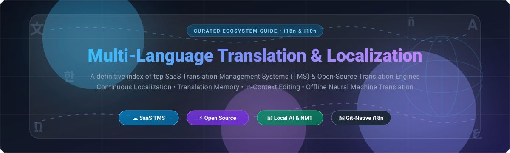

# 🌐 Awesome Multi-Language Translation & Localization

  

  <strong>🚀 A curated collection of leading Translation Management Systems (TMS), software internationalization (i18n), localization (l10n), and open-source machine translation (MT) engines.</strong>

  <a href="#-sector-overview--market-dynamics">📈 Sector Overview</a> •
  <a href="#-saas--hosted-platforms">☁️ SaaS Platforms</a> •
  <a href="#-open-source-software">⚡ Open-Source Solutions</a> •
  <a href="#-comparison-at-a-glance">📊 Feature Matrix</a> •
  <a href="#-star-history">⭐ Star History</a> •
  <a href="#-support">☕ Support</a> •
  <a href="#-contributing">🤝 Contributing</a>

---

## 📋 Table of Contents

- [📈 Sector Overview & Market Dynamics](#-sector-overview--market-dynamics)
- [☁️ SaaS / Hosted Platforms](#-saas--hosted-platforms)
  - [SaaS Solutions Comparison](#saas-solutions-comparison)
  - [DeepL Pro](#deepl-pro)
  - [Phrase](#phrase)
  - [Lokalise](#lokalise)
  - [Crowdin](#crowdin)
  - [Transifex](#transifex)
- [⚡ Open-Source Software](#-open-source-software)
  - [Open-Source Solutions Overview](#open-source-solutions-overview)
  - [LibreTranslate](#libretranslate)
  - [Argos Translate](#argos-translate)
  - [Weblate](#weblate)
  - [Tolgee](#tolgee)
  - [Inlang](#inlang)
  - [Pontoon](#pontoon)
  - [Pootle](#pootle)
  - [Accent](#accent)
  - [Translate Toolkit](#translate-toolkit)
  - [LTEngine](#ltengine)
  - [Localess](#localess)
- [📊 Comparison at a Glance](#-comparison-at-a-glance)
- [⭐ Star History](#star-history)
- [💖 Support](#-support)
- [🤝 Contributing](#-contributing)
- [📄 License](#-license)

---

## 📈 Sector Overview & Market Dynamics

The global Translation Management System (TMS) and software localization market is estimated at approximately **$2.1 billion to $2.5 billion**, rapidly compounding at a **15% to 17% CAGR** toward an anticipated **$5.8+ billion** by 2030, accelerated by neural machine translation (NMT) and generative LLM integration. The sector is **highly fragmented**, characterized by a competitive mix of multi-million/billion-dollar localization conglomerates, high-growth venture-backed SaaS platforms, and specialized open-source tools addressing niche developer workflows rather than a winner-take-all monopoly.

---

## ☁️ SaaS / Hosted Platforms

Commercial, cloud-hosted Multi-Language Translation and Localization platforms. These services deliver enterprise integrations, automated workflows, collaborative CAT tools, and managed translation infrastructure.

### SaaS Solutions Comparison

> The table below is sorted descending by **Company Scale (Valuation / Revenue)**.

| Platform | Starting Price (Paid Tier) | Free Tier Limits / Free Trial | Company Scale (Valuation / Revenue) | Target Audience | Primary Integrations |
| :--- | :--- | :--- | :--- | :--- | :--- |
| **[DeepL Pro](https://www.deepl.com/pro)** | **$8.74/mo** (Pro Starter billed annually; API starts at ~$26/mo base + usage) | **Free Plan:** 50,000 characters/mo, 1 file translation/mo (5 MB max), 1 glossary (5 entries). *API Free tier: 1M lifetime characters evaluation limit.* | **$2 Billion valuation** (~$185M ARR) | Developers, translators & enterprises needing elite NMT translation quality | REST API, Windows/macOS native apps, Google Docs/MS Word plugins |
| **[Phrase](https://phrase.com)** | **$27/mo** (Freelancer tier; Enterprise/Team suites scale from $525/mo to $1,245/mo) | **No permanent free tier**. Offers a **14-day free trial** with full access to the core localization platform features. | **$60M – $72M ARR** (Acquired by The Carlyle Group; €27M+ institutional funding/debt) | High-scale product teams, language service providers & enterprise orgs | GitHub, GitLab, Bitbucket, Figma, Jira, 30+ Machine Translation engines |
| **[Lokalise](https://lokalise.com)** | **$144/mo** (Explorer tier billed annually; Growth tier starts at ~$499/mo) | **No permanent free tier**. Offers a **14-day free trial** with Explorer quota and enterprise-grade features; no credit card required. | **$39M ARR** ($56M venture capital raised; valued in high hundreds of millions) | Fast-moving mobile and web development teams, product managers & designers | GitHub, GitLab, Bitbucket, Figma, Sketch, Adobe XD, Contentful, Jira |
| **[Crowdin](https://crowdin.com)** | **$59/mo** (Pro tier; Team tier starts at $179/mo) | **Free Plan:** Up to **60,000 hosted words**, 1 private project, unlimited public projects, 1 integration, unlimited translators. | **$13M – $14M ARR** (Profitable, self-funded / bootstrapped) | Agile developer teams, continuous localization workflows & OSS projects | GitHub, GitLab, Bitbucket, Azure Repos, Jira, Slack, Figma, VS Code |
| **[Transifex](https://www.transifex.com)** | **$135/mo** (Starter tier billed annually, or $179 billed monthly) | **Free Plan:** Up to **1,000 hosted words**, 1 project, 2 target languages. *Also offers a 14-day free trial and a dedicated free plan for open-source.* | **$5M – $14M ARR** ($7.4M funding raised; acquired by PARC Partners, then XTM International) | Global digital brands, open-source communities & cloud-native web apps | GitHub, GitLab, Bitbucket, Figma, Zendesk, WordPress, Contentful |

---

### DeepL Pro
**Type:** 🧠 High-Precision Neural Machine Translation Engine & API  
DeepL Pro is an industry-benchmark AI machine translation service known for translations that regularly surpass legacy engines in grammatical nuance and natural phrasing, particularly for European, Asian, and Latin languages. It is widely embedded into commercial TMS tools as an external MT engine and integrated directly by engineering teams via its developer API.  
* **✨ Key Advantages:** Unmatched contextual translation accuracy, rigorous GDPR compliance, encrypted end-to-end data processing, and document formatting preservation (PDF, DOCX, PPTX).  
* **⚠️ Trade-off:** Focuses strictly on translation engine output and document translation rather than end-to-end string extraction or multi-branch TMS lifecycle orchestration.  
* **🎯 Best for:** Development and enterprise teams requiring state-of-the-art automated translation quality as an integrated backend component.

### Phrase
**Type:** 🏢 Enterprise Language Experience Platform & Comprehensive TMS  
Phrase (formerly Memsource) provides one of the broadest feature ecosystems across the localization sector, pairing software string localization with full-scale translation memory management, vendor portals, and automated quality scoring.  
* **✨ Key Advantages:** Integrates with 30+ machine translation engines, automated AI workflow triggers, advanced translation memory indexing, and in-context web editors.  
* **⚠️ Trade-off:** Premium enterprise plans entail custom enterprise sales agreements and a steep learning curve for non-specialized team members.  
* **🎯 Best for:** Large enterprise organizations, global brands, and language service agencies running complex localization pipelines across dozens of locales.

### Lokalise
**Type:** 🎨 Design-Driven, Collaborative TMS for Product & Engineering Teams  
Lokalise is built around developer ergonomics and design team workflows, prioritizing visual context and real-time collaboration.  
* **✨ Key Advantages:** Visual in-context editing with screenshot OCR mapping, bi-directional Figma and Adobe XD plugins, automated branch-based string updates, and over-the-air (OTA) updates for mobile apps.  
* **⚠️ Trade-off:** High entry-level pricing ($144/mo) and tiered pricing based on active hosted strings, with fewer native MT engines than Phrase.  
* **🎯 Best for:** Product squads, cross-functional UX/UI design teams, and mobile developers who value smooth visual workflows and rapid onboarding.

### Crowdin
**Type:** 💻 Developer-First Continuous Localization & Translation Platform  
Crowdin is an agile-oriented localization suite that synchronizes translation files directly against Git repositories, transforming localization into an automated step in continuous deployment.  
* **✨ Key Advantages:** Bi-directional synchronization with GitHub, GitLab, and Bitbucket; strong marketplace with 500+ plugins; over-the-air mobile delivery; and generous community programs for public OSS repositories.  
* **⚠️ Trade-off:** Interface can become complex on enterprise repositories with hundreds of branching files and distributed modules.  
* **🎯 Best for:** Software engineers and open-source projects requiring automated, pull-request-driven continuous localization.

### Transifex
**Type:** 🌐 Cloud-Native Localization Management & Translation Platform  
Transifex automates the translation workflow for web applications, mobile platforms, and customer support content.  
* **✨ Key Advantages:** Transifex Native (code-level OTA delivery bypassing file-handling bottlenecks), REST APIs, translation memory leveraging, and community-driven crowdsourcing modules.  
* **⚠️ Trade-off:** String limits on lower-tier pricing tiers require careful repository hygiene to prevent overages.  
* **🎯 Best for:** Web startups and continuous SaaS platforms seeking streamlined crowdsourcing or cloud-native SDK string delivery.

---

## ⚡ Open-Source Software

Self-hosted, community-driven Multi-Language Translation and Localization tools. The open-source ecosystem covers complete web-based TMS suites, offline-capable machine translation engines, and Git-native i18n libraries.

### Open-Source Solutions Overview

> The table below is sorted descending by **GitHub Stars**.

| Project | GitHub Stars | License | Primary Tech Stack | Core Architecture |
| :--- | :--- | :--- | :--- | :--- |
| **[LibreTranslate](#libretranslate)** |  | AGPL-3.0 | Python / Argos Translate | Self-hosted, offline Machine Translation API |
| **[Argos Translate](#argos-translate)** |  | MIT | Python / OpenNMT / CTranslate2 | Open-source offline neural machine translation engine library |
| **[Weblate](#weblate)** |  | GPL-3.0 | Python / Django / PostgreSQL / Redis | Web-based collaborative TMS with bidirectional VCS integration |
| **[Tolgee](#tolgee)** |  | Apache-2.0 | Kotlin / Spring Boot / TypeScript | Modern web TMS with in-context live clicking & SDKs |
| **[Inlang](#inlang)** |  | Apache-2.0 | TypeScript / Node.js | Git-native i18n developer ecosystem & web translation editor |
| **[Pontoon](#pontoon)** |  | BSD-3-Clause | Python / Django / PostgreSQL | Mozilla's production in-context web localization system |
| **[Pootle](#pootle)** |  | GPL-3.0 | Python / Django | Classic web-based translation management tool |
| **[Accent](#accent)** |  | Apache-2.0 | Elixir / Phoenix / React | Developer-oriented collaborative translation platform with API sync |
| **[Translate Toolkit](#translate-toolkit)** |  | GPL-2.0 | Python | Essential localization format converters & quality-check engine |
| **[LTEngine](#ltengine)** |  | MIT / Open Source | Rust / llama.cpp / Gemma-3 LLM | High-fidelity local AI translation engine with GPU acceleration |
| **[Localess](#localess)** |  | MIT | Angular / Firebase / Google Cloud | Schema-driven headless CMS & AI-assisted localization platform |

---

### LibreTranslate
  
**Stack:** 🐍 Python / Argos Translate | **License:** AGPL-3.0  
**Repo:** [LibreTranslate/LibreTranslate](https://github.com/LibreTranslate/LibreTranslate)  
LibreTranslate is a free, self-hosted, offline-capable machine translation API built on top of the open-source Argos Translate library. Unlike Google Translate or Microsoft Translator APIs, it operates 100% independently of commercial third-party cloud infrastructure.  
* **✨ Key Features:** Fast Docker container deployment, automatic language detection, batch translation endpoints, zero API telemetry, and SDK clients available in Rust, TypeScript, Python, and C#.  
* **⚠️ Trade-off:** Translation fluency on rare language pairs or complex colloquial syntax may fall behind proprietary frontier LLMs.  
* **🎯 Best for:** Privacy-first self-hosted deployments, offline edge devices, and internal services requiring local machine translation.

### Argos Translate
  
**Stack:** 🐍 Python / OpenNMT / CTranslate2 | **License:** MIT  
**Repo:** [argosopentech/argos-translate](https://github.com/argosopentech/argos-translate)  
Argos Translate is an open-source, modular neural machine translation library designed to be embedded directly into desktop and server Python applications without requiring server-side API calls.  
* **✨ Key Features:** Cross-platform offline language models, package management for on-demand language pack downloads, OpenNMT-py and CTranslate2 runtime optimization for high-throughput CPU/GPU inference.  
* **⚠️ Trade-off:** Requires explicit management of downloaded model package dependencies and memory footprint on low-resource environments.  
* **🎯 Best for:** Python developers wanting an embedded, zero-network-dependency translation engine inside local tools or desktop apps.

### Weblate
  
**Stack:** 🐍 Python / Django / PostgreSQL / Celery / Redis | **License:** GPL-3.0  
**Repo:** [WeblateOrg/weblate](https://github.com/WeblateOrg/weblate)  
Weblate is the gold standard of self-hosted, open-source Translation Management Systems, maintaining native two-way synchronization with Git and Mercurial repositories. When translators edit strings in Weblate, commits are pushed directly back into your source code repository.  
* **✨ Key Features:** Native support for 50+ file formats (PO, XLIFF, JSON, Android XML, iOS Strings, YAML), 50+ automated quality and syntax checks, translation memory, glossary enforcement, and deep machine translation integration (DeepL, LibreTranslate, Weblate AI).  
* **⚠️ Trade-off:** High server resource consumption on large installations hosting hundreds of concurrent repositories and large linguistic databases.  
* **🎯 Best for:** Open-source ecosystems, enterprise engineering teams, and projects requiring bidirectional Git automation and strict data sovereignty.

### Tolgee
  
**Stack:** ☕ Kotlin / Spring Boot / TypeScript / React | **License:** Apache-2.0  
**Repo:** [tolgee/tolgee-platform](https://github.com/tolgee/tolgee-platform)  
Tolgee is an innovative open-source localization platform built for modern web architectures (React, Angular, Vue, Svelte, Next.js). It introduces an in-context translation experience: developers and translators hold `Alt`/`Option` and click on any translated UI string in their live web application to update it instantly.  
* **✨ Key Features:** True in-context in-app translation dialogs, automated screenshot generation, AI-powered contextual translation (leveraging OpenAI and Claude), translation memory, and single-container Docker hosting.  
* **⚠️ Trade-off:** Cloud sync and in-context features work best when adopting Tolgee’s native frontend SDKs.  
* **🎯 Best for:** Modern frontend developers seeking effortless in-context UI translations without manual string key hunting.

### Inlang
  
**Stack:** ⚡ TypeScript / Node.js | **License:** Apache-2.0  
**Repo:** [generaltranslation/inlang](https://github.com/generaltranslation/inlang)  
Inlang is a developer-centric, Git-native internationalization infrastructure. Instead of storing localized strings inside a remote proprietary SaaS database, Inlang reads and writes your translation files directly in your Git repository.  
* **✨ Key Features:** Fink web translation editor for non-technical translators (submits changes via Git pull requests), Paraglide JS compiled type-safe i18n runtime, VS Code extension (Sherlock), and CI/CD validation checks.  
* **⚠️ Trade-off:** Relies on GitHub accounts and Git workflows, requiring a short learning curve for non-technical linguistic agencies.  
* **🎯 Best for:** GitOps-driven development teams that want complete version control ownership over every translation string.

### Pontoon
  
**Stack:** 🐍 Python / Django / PostgreSQL | **License:** BSD-3-Clause  
**Repo:** [mozilla/pontoon](https://github.com/mozilla/pontoon)  
Pontoon is Mozilla's battle-tested localization platform powering the localization of Firefox, MDN Web Docs, and Mozilla infrastructure across hundreds of locales.  
* **✨ Key Features:** Real-time in-context website preview editing, native integration with Project Fluent (.ftl) localization framework, automated translation suggestions, and community contributor role governance.  
* **⚠️ Trade-off:** Deeply architected around Mozilla’s specific linguistic workflows and Fluent file paradigms.  
* **🎯 Best for:** Community-driven crowd translation initiatives and applications leveraging Project Fluent for complex linguistic inflection.

### Pootle
  
**Stack:** 🐍 Python / Django | **License:** GPL-3.0  
**Repo:** [translate/pootle](https://github.com/translate/pootle)  
Pootle is one of the foundational open-source web translation portals, created by the Translate house to help open-source communities localize software strings collaboratively.  
* **✨ Key Features:** Translation memory integration, glossary terminology lookup, granular role-based permissions, and tight PO file format handling.  
* **⚠️ Trade-off:** Legacy architecture with slower modern release cycles compared to modern platforms like Weblate and Tolgee.  
* **🎯 Best for:** Established open-source projects with traditional gettext PO translation archives.

### Accent
  
**Stack:** 💧 Elixir / Phoenix / React | **License:** Apache-2.0  
**Repo:** [mirego/accent](https://github.com/mirego/accent)  
Accent is an open-source collaborative translation tool engineered specifically for developer workflows. It acts as an asynchronous coordination layer between development teams and translators.  
* **✨ Key Features:** Real-time multi-user editing, conflict resolution history, full revision timeline rollbacks, CLI tooling for continuous integration, and seamless JSON/YAML/PO file sync.  
* **⚠️ Trade-off:** Smaller community plugin ecosystem compared to Weblate.  
* **🎯 Best for:** Elixir and web developers who want lightweight, collaborative translation management with complete audit trails.

### Translate Toolkit
  
**Stack:** 🐍 Python | **License:** GPL-2.0  
**Repo:** [translate/translate](https://github.com/translate/translate)  
The Translate Toolkit is an indispensable collection of Python command-line utilities and software libraries for localization engineering. It provides the computational foundation used by many translation platforms.  
* **✨ Key Features:** Bi-directional converters between PO, XLIFF, CSV, JSON, Android XML, and Word formats; comprehensive automated translation quality checkers (pofilter); and translation memory extraction algorithms.  
* **⚠️ Trade-off:** CLI and library toolkit only; does not provide a web interface for translators.  
* **🎯 Best for:** Localization engineers and DevOps developers building custom translation CI pipelines and format conversion scripts.

### LTEngine
  
**Stack:** 🦀 Rust / llama.cpp / Gemma-3 LLM | **License:** MIT / Open Source  
**Repo:** [LibreTranslate/LTEngine](https://github.com/LibreTranslate/LTEngine)  
LTEngine is an advanced, self-hosted local AI machine translation API written in high-performance Rust, fully compatible with LibreTranslate API clients and endpoints.  
* **✨ Key Features:** Powered by quantized large language models (Gemma-3-27B) executed locally via `llama.cpp`, GPU acceleration via CUDA, Metal, and Vulkan, delivering translation quality rivaling proprietary frontier models.  
* **⚠️ Trade-off:** Requires significant GPU VRAM (e.g., 24GB VRAM for gemma3-27b) for low-latency production throughput.  
* **🎯 Best for:** AI infrastructure teams wanting local, sovereign, LLM-based machine translation with maximum fidelity.

### Localess
  
**Stack:** 🅰️ Angular / Firebase / Google Cloud | **License:** MIT  
**Repo:** [Lessify/localess](https://github.com/Lessify/localess)  
Localess bridges the gap between headless Content Management Systems and localization management, designed with native Firebase serverless infrastructure.  
* **✨ Key Features:** AI-assisted translation powered by Google Translate, schema definitions for structured multilingual content, zero-build real-time text updates, and sub-20ms CDN delivery over Google Global CDN.  
* **⚠️ Trade-off:** Architectural dependency on Google Firebase and Google Cloud Platform services.  
* **🎯 Best for:** Teams built on Firebase seeking serverless, lightning-fast CDN-cached multilingual UI delivery.

---

## 📊 Comparison at a Glance

| Software | Solution Type | License | Tech Stack | Translation Memory | Version Control (Git) | Machine Translation | Self-Hosted | Primary Strength |
| :--- | :--- | :--- | :--- | :---: | :---: | :---: | :---: | :--- |
| **DeepL Pro** | SaaS / API | Proprietary | Cloud Native | ✅ | ❌ | ✅ Native NMT | ❌ | Industry-leading translation quality & nuance |
| **Phrase** | SaaS Platform | Proprietary | Cloud Native | ✅ | ✅ GitHub / GitLab | ✅ 30+ Engines | ❌ | Enterprise feature breadth & automated vendor orchestration |
| **Lokalise** | SaaS Platform | Proprietary | Cloud Native | ✅ | ✅ GitHub / GitLab | ✅ Limited | ❌ | Best-in-class UX, Figma sync & screenshot mapping |
| **Crowdin** | SaaS Platform | Proprietary | Cloud Native | ✅ | ✅ Native Git Sync | ✅ 10+ Engines | ❌ | Continuous localization & open-source friendly ecosystem |
| **Transifex** | SaaS Platform | Proprietary | Cloud Native | ✅ | ✅ Git / Native SDK | ✅ Multi-engine | ❌ | Transifex Native OTA code delivery & community portals |
| **LibreTranslate** | Open-Source Engine | AGPL-3.0 | Python / Argos | N/A (Engine) | ❌ | ✅ Self-hosted | ✅ | Offline, private machine translation API |
| **Argos Translate** | Open-Source Library | MIT | Python / CTranslate2 | N/A (Library) | ❌ | ✅ Embedded MT | ✅ | Embeddable Python offline neural machine translation |
| **Weblate** | Open-Source TMS | GPL-3.0 | Python / Django | ✅ | ✅ Bidirectional Git | ✅ Multi-provider | ✅ | Complete VCS integration & support for 50+ formats |
| **Tolgee** | Open-Source TMS | Apache-2.0 | Kotlin / TypeScript | ✅ | ✅ Git / CLI | ✅ AI + MT | ✅ | In-context live click-to-translate & modern web SDKs |
| **Inlang** | Open-Source TMS | Apache-2.0 | TypeScript / Node | ✅ | ✅ Direct Repo Commits | ✅ Optional AI | ✅ | 100% Git-native translation workflow & PR reviews |
| **Pontoon** | Open-Source TMS | BSD-3-Clause | Python / Django | ✅ | ✅ Mozilla VCS | ✅ Suggestions | ✅ | In-context live web translation & Fluent (.ftl) integration |
| **Pootle** | Open-Source TMS | GPL-3.0 | Python / Django | ✅ | ❌ | ✅ Plugins | ✅ | Established community web-based PO file management |
| **Accent** | Open-Source TMS | Apache-2.0 | Elixir / React | ✅ | ✅ Git / CLI | (Check) | ✅ | Real-time collaborative synchronization & version control audit |
| **Translate Toolkit**| Open-Source Tools | GPL-2.0 | Python | ✅ | ❌ | ❌ | ✅ | File format conversion & automated linguistic quality filters |
| **LTEngine** | Open-Source Engine | MIT | Rust / llama.cpp | N/A (Engine) | ❌ | ✅ LLM-Powered | ✅ | High-accuracy local translation using local LLM models |
| **Localess** | Open-Source CMS/TMS | MIT | Angular / Firebase | ❌ | ❌ | ✅ Google Translate | ✅ (Firebase) | Serverless headless CMS with sub-20ms global CDN caching |

---

## 📈 Star History

---

## 💖 Support

A huge thank you to everyone exploring, contributing to, and starring this project! ⭐

If this curated repository helped you or your team discover the ideal Translation Management System or open-source localization framework:

- ⭐ **Star this repository** to support discoverability.
- 🍴 **Fork the repo** to contribute additions or share it across your organization.
- 📢 **Share it** with fellow internationalization (i18n) and localization (l10n) developers.
- ☕ **Buy me a coffee / Sponsor**: If you'd like to support ongoing curation and maintenance, consider sponsoring via the [GitHub Sponsors Dashboard](https://github.com/sponsors/ishandutta2007).

---

## 🤝 Contributing

Contributions, suggestions, and corrections are warmly welcomed! To suggest a new tool or update an existing listing:

1. Fork this repository.
2. Create a descriptive branch (`git checkout -b add-tool-name`).
3. Add the project under the appropriate section with:
   - Project name, official website, and GitHub repository URL.
   - Tech stack, license, and primary architectural approach.
   - Objective benefits and clear trade-offs.
   - For open-source tools: Include the `style=social&color=white` GitHub star badge linking to the repository stargazers page.
4. Ensure all links and markdown formatting render correctly.
5. Submit a Pull Request.

---

## 📄 License

This repository is dedicated to the public domain under the [Creative Commons Zero v1.0 Universal](https://creativecommons.org/publicdomain/zero/1.0/) (CC0-1.0) license. The individual software packages, services, and libraries referenced herein are properties of their respective owners and governed by their specific licenses.
